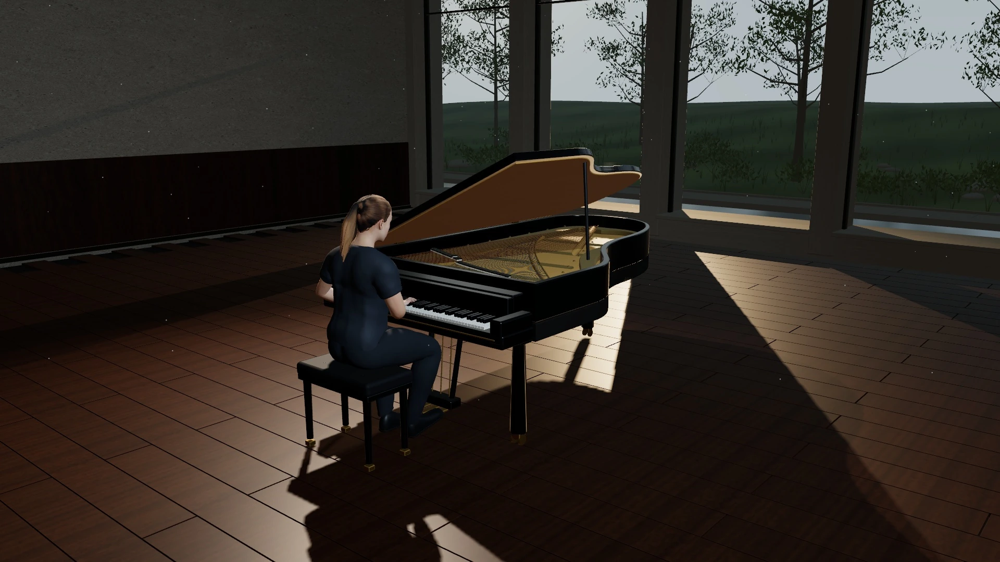

# Daybreak · Piano Film

A 3-minute, 53-second piano performance rendered in your browser: a virtual pianist, animated hands and keys, a concert grand, and a moving camera inside a sunlit timber-and-stone pavilion.

[Watch the demo](https://daybreak.whyjs.com) · [Original reference](https://daybreak-piano-film.lexn8.chatgpt.site) · [Credits](public/assets/credits.txt) · [Rights and licenses](RIGHTS.md)



## What’s inside

- A real-time Three.js scene with a detailed piano, performer, garden, lighting, and cinematic camera movement.
- Piano audio synchronized with the score, animated hands, and moving keys.
- React playback controls: play/pause, restart, seek, volume, mute, fullscreen, and expandable credits.
- A self-contained static build with local audio, model, textures, and runtime dependencies. No backend or API keys are needed.

This is a **public-build reconstruction** of the reference site, captured on September 16, 2026. It contains formatted application modules and the deployed assets; the original TypeScript/JSX source and authoring projects were not available. **Public access does not grant a license to reuse all of the contents.** Existing third-party licenses are preserved; the recovered custom code and media have no confirmed reuse license. See [RIGHTS.md](RIGHTS.md).

## Run locally

You need **Node.js 20 or newer** and npm. A modern browser with WebGL support is required to play the scene.

```sh
git clone https://github.com/AlexLisong/daybreak-piano.git
cd daybreak-piano
npm ci
npm run build
npm run check
npm run preview
```

Open **http://127.0.0.1:4173** and press Play. Audio starts after a user gesture. The preview server binds to your own computer and supports byte-range requests for audio seeking.

To use another port on macOS or Linux:

```sh
PORT=4191 npm run preview
```

### Commands

| Command           | What it does                                                                                            |
| ----------------- | ------------------------------------------------------------------------------------------------------- |
| `npm ci`          | Installs the pinned development dependency, Prettier.                                                   |
| `npm run build`   | Recreates `dist/` from `src/`, `public/`, and the module mapping.                                       |
| `npm run check`   | Checks that local asset references in the built HTML, JavaScript, and CSS resolve. Run the build first. |
| `npm run preview` | Serves `dist/` locally on port 4173.                                                                    |
| `npm run dev`     | Alias for the preview server; it does not watch or rebuild source.                                      |

## Explore and edit

| Path                              | Purpose                                                                                                        |
| --------------------------------- | -------------------------------------------------------------------------------------------------------------- |
| `src/application.js`              | Playback UI, audio/score synchronization, timeline, volume, fullscreen, and credits.                           |
| `src/scene.js`                    | Pianist, piano, room, garden, materials, animation, camera, and scene cleanup.                                 |
| `src/styles.css`                  | Typography, opening screen, controls, and responsive layout.                                                   |
| `src/index.html`                  | Initial document and React bootstrap data.                                                                     |
| `public/assets/`                  | Runtime chunks, audio, score, character model, texture maps, posters, and attribution.                         |
| `scripts/`                        | Dependency-free build, asset check, and local preview scripts.                                                 |
| `source-map.json`                 | Maps editable modules to the filenames expected by the runtime; this is not a JavaScript debugging source map. |
| `docs/public-asset-manifest.json` | Capture-time hashes and sizes of the original public assets.                                                   |

After making an authorized change, run `npm run build` and `npm run check`, then refresh your browser. Edit `src/` or `public/`; `dist/` is generated and ignored by Git.

Keep the module filenames in `source-map.json` aligned with their imports. Preserve the significant whitespace and embedded bootstrap data in `src/index.html`: reformatting that document can cause React hydration errors, so it is intentionally excluded from Prettier.

The capture manifest records the original public files, not the formatted source or every later build. Some identifiers and runtime chunks remain minified because this is a reconstruction.

## Static hosting

The build output in `dist/` is the complete static site. For a deployment you are authorized to make, serve that directory at a domain’s **root path** using a static host with correct JavaScript, GLB, and audio content types. Byte-range support allows efficient audio seeking. Hosting under a repository subpath requires updating the root-relative asset URLs.

The preview server is intended for local use. Deployment credentials, production host configuration, and deployment receipts are not included in this public repository.

## Verification and limitations

`npm run check` validates local asset references; it does not exercise browser interactions. For a smoke check, start playback, pause, seek, restart, change volume, and open credits. The timeline and volume sliders support keyboard input. Fullscreen availability depends on the browser and embedding environment.

The original Three.js build can emit non-fatal warnings about the shadow-map mode and environment blur sample count. Rendering speed depends on your GPU; the original model, textures, and scene complexity are retained. The application does not need the reference host at runtime, although its public URL remains in provenance and page metadata.

## Credits and reuse

Piano recordings are from **Salamander Grand Piano v3 by Alexander Holm (CC BY 3.0)**. The human model derives from the **MakeHuman / MPFB model distributed through met4citizen’s TalkingHead (CC0)**. Dependency notices include Three.js, React, and other bundled libraries.

Read the complete [asset credits](public/assets/credits.txt), [software notices](public/assets/software-notices.txt), and [rights guide](RIGHTS.md) before reusing or redistributing material. The licenses for samples, the base model, and dependencies do not automatically license the complete composition, modified artwork, or custom application code.

## Contributing

Issues about reproducibility, documentation, or missing attribution are welcome. Keep changes focused, run the build and asset checks, and describe the browser behavior you verified. Do not submit credentials, private deployment details, or assets you lack permission to share. Reuse and modification of recovered material remain subject to the rights described above.
